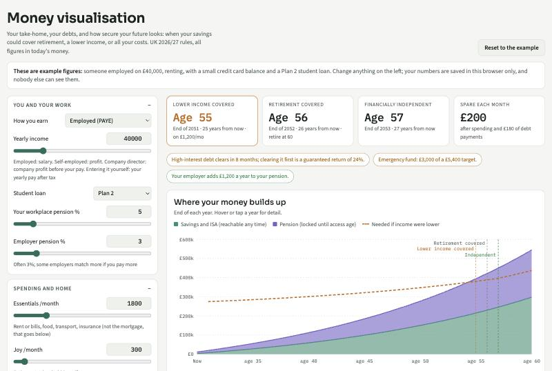
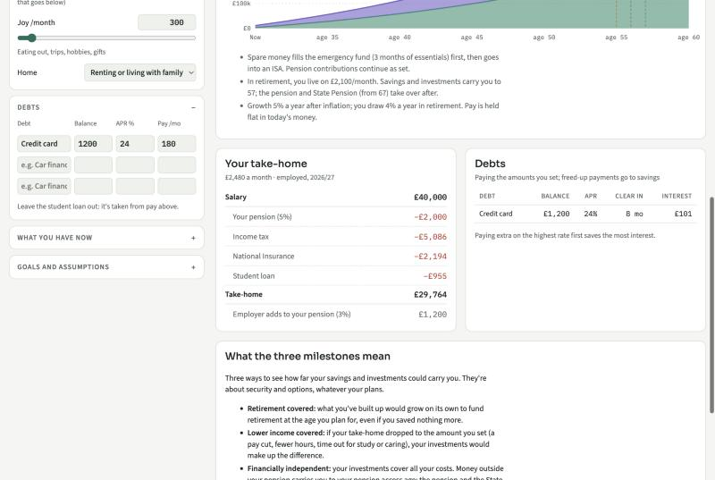
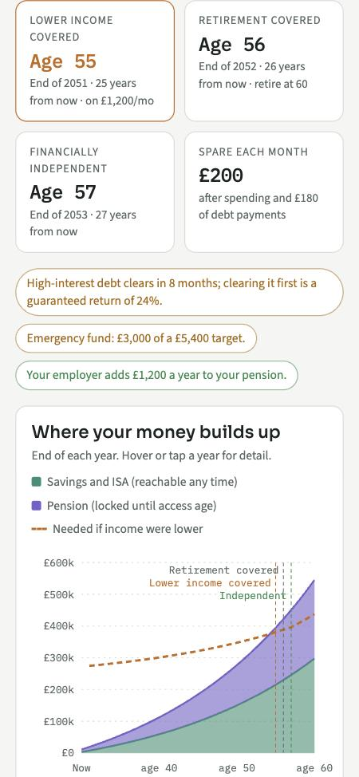
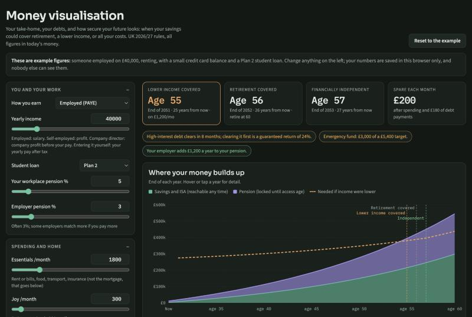

# My life flows with ease

Get life admin and money out of your head and let Claude keep them ticking over.

It's named after its home page, your **My life flows with ease** doc. Your money doc, **Money uplifts me**, and the **Money visualisation** are linked from the top of it, so everything starts in one place:

```
My life flows with ease  (life admin: start here)
 ├── Money uplifts me    (money doc, linked at the top)
 │    └── Key figures, payday plan, goals, calendar… (one tab each)
 └── Money visualisation (interactive page, linked at the top of both docs)
```



## What you get

**Money visualisation** (pictured): an interactive page with sliders and charts. Move a slider and it works out your take-home pay, how long your debts will take to clear, and how secure your future looks: when your savings could cover retirement, a drop in income, or all your costs.

**My life flows with ease**: one table of everything admin (health, travel, documents, home, family), most urgent first, colour-coded by who it's waiting on. Each theme opens its own tab for the detail, so the main view stays short. [See the template →](templates/my-life-flows-with-ease/README.md)

**Money uplifts me**: a short main view (where you are, wins, next actions) with everything else one click away: key figures and charts, payday plan, debts, goals, calendar and more. [See the template →](templates/money-uplifts-me/README.md)

**Routines**: scheduled check-ins that read your email (read-only), keep the docs up to date and send you a short, kind nudge: daily, weekly, on payday and quarterly. You choose which ones. [See them all →](routines/)

## Set it up (about 20 minutes)

You need a paid Claude plan and the Claude desktop app.

1. Download this folder: the green **Code** button above → **Download ZIP**, then unzip it somewhere you'll keep it (e.g. Documents).
2. Open it in Claude, either way works:
   - **Claude Code** (the **Code** tab): choose this folder, then type **set me up**.
   - **Cowork**: start a task, connect this folder, then type **read CLAUDE.md in this folder and set me up**.

Claude asks a few questions (including which country you live in), makes your docs, publishes your money visualisation and creates the routines you pick. Your own details stay on your computer and in your Claude account; nothing goes back to this repo.

## More about the money visualisation

The money visualisation is a single web page: [`visualisation/money-visualisation.html`](visualisation/money-visualisation.html). During setup, Claude publishes **your own private copy** to your Claude account, so you get a link that's yours. Whatever you type into it is saved in your browser only, and nobody else can see it.

It opens with example figures. Change anything on the left and everything updates:

| | |
| --- | --- |
|  |  |
| Take-home broken down line by line, and how long each debt takes to clear | Works on a phone |

It follows your device's light or dark setting:



The same "how your security builds up" chart goes in the **Key figures** tab of your money doc. Once you've added your numbers, Claude draws it there for you.

## Outside the UK?

It works anywhere. Everything country-specific (tax deadlines, savings accounts, pensions, where to get free help) lives in one file per country in [`locales/`](locales/). The UK file is complete. For anywhere else, Claude builds one during setup from official sources and asks you to check it.

The money visualisation's built-in tax maths is UK-only. Elsewhere you enter your take-home pay yourself, and everything else works the same.

## What's in here

| Folder | |
| --- | --- |
| `templates/` | The two docs. Each is a folder with one file per tab, so you can click through them here on GitHub |
| `visualisation/` | The money visualisation (one HTML file) |
| `routines/` | One file per scheduled routine, so you can read exactly what each one does |
| `locales/` | Country rules. Add your country here |
| `CLAUDE.md` | The setup instructions Claude follows |

## Good to know

- Routines only **read** email. They never send, delete, move money or log into a bank.
- The money parts are a planning aid, not financial advice.
